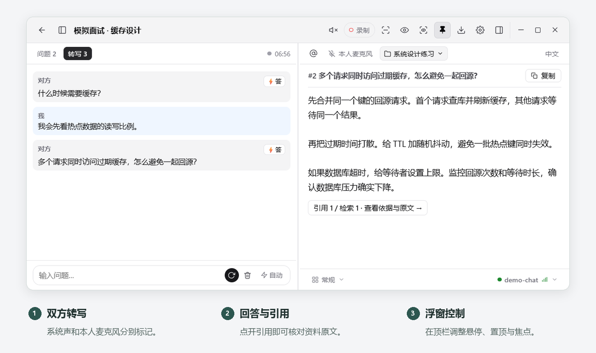
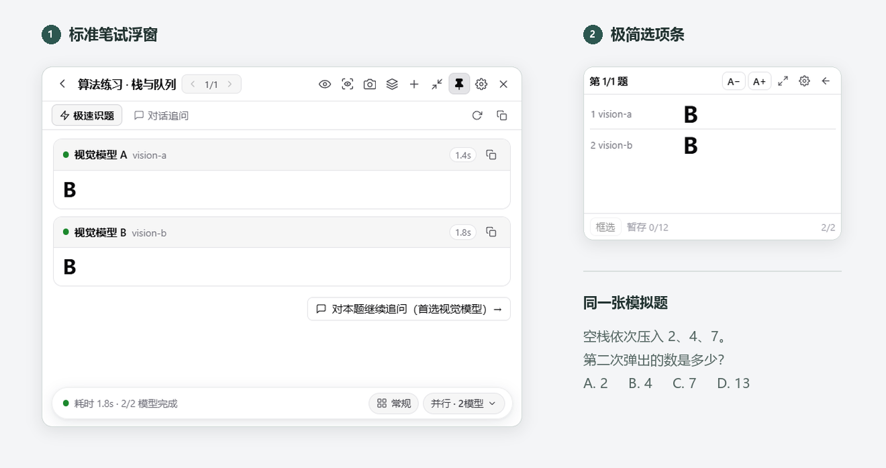
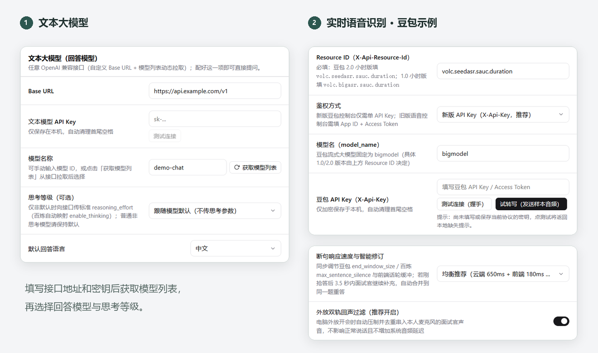
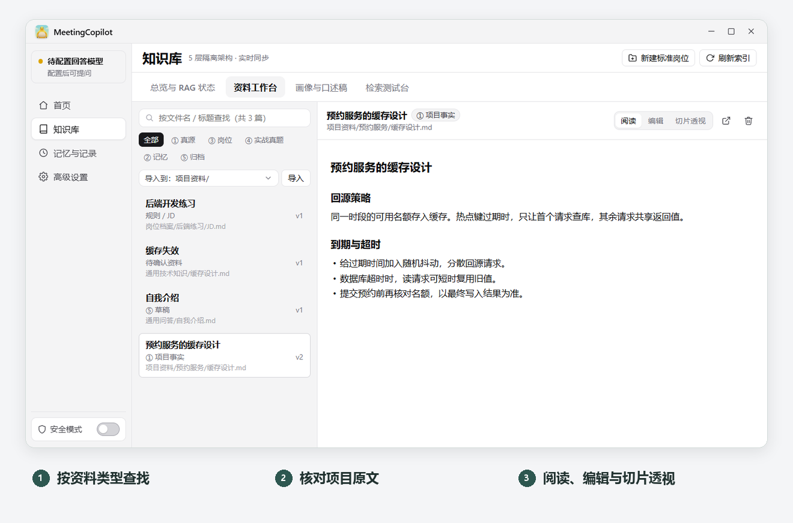

<p align="center">
  
</p>

<h1 align="center">MeetingCopilot</h1>

<p align="center">Windows 上的本地优先面试与笔试工作台，使用你自己的模型 API。</p>

<p align="center">
  
  
  
  <a href="./licenses/MeetingCopilot-LICENSE.txt"></a>
</p>

<p align="center">
  <a href="#quick-start">快速上手</a> ·
  <a href="#preview">功能预览</a> ·
  <a href="#configure">模型与语音配置</a> ·
  <a href="#shortcuts">快捷键</a> ·
  <a href="#build">源码构建</a>
</p>



<a id="quick-start"></a>

## 快速上手

1. 解压 `MeetingCopilot-V3.2.zip`，双击包内带应用图标的 **`MeetingCopilot.exe`**，也可以使用 `启动.cmd`。
2. 打开 **高级设置 → 模型接口 → 文本大模型**，填写服务商提供的 OpenAI 兼容 Base URL 和 API Key。
   点击 **获取模型列表** 选择模型，或手动填写模型 ID，再点 **测试连接**。
3. 回到 **首页 → 面试助手**，选择模板并点击 **开始**。第一次只想打字时，可在会前关闭自动音频采集。
   进入工作台，在左下角输入「什么时候需要缓存？」并按 Enter，右栏会逐步显示回答。

一次打字提问只需配置回答模型。接下来可以按用途添加服务：

| 我想做什么 | 接下来在哪里设置 |
| --- | --- |
| 听到面试官的问题就生成回答 | **高级设置 → 语音与录制**，选择协议、填写凭证，点击 **试转写（发送样本音频）** |
| 会后回看我和对方说过的话 | 用 **系统音频模式** 开场，勾选 **同时转写我的回答（本人麦克风）** |
| 练习屏幕上的笔试题 | 在 **模型接口 → 截图多模态模型** 启用截图问答，添加支持图片输入的接口，然后从首页进入 **笔试助手** |
| 让回答参考我的项目经历 | 在 **知识库 → 总览与 RAG 状态** 选择本地资料文件夹，开启面试中使用，按需选择岗位 |

<a id="preview"></a>

## 功能预览

### 面试中的两路声音

线上面试选 **系统音频模式** 接收会议软件播放的声音。线下练习可选 **麦克风模式**，用麦克风接收对方的提问。
在系统音频模式中开启本人麦克风后，实时转写和历史记录会分别标出「对方」与「我」。

- 在 **问题** 与 **转写** 间切换。点击历史题可回看旧回答，也可合并相邻碎句。
- 右侧显示当前问题的流式回答。点 **查看依据与原文** 核对资料出处，或展开辅助栏查看资料、备忘和导出工具。
- 需要保留声音时，在会前或工作台顶栏开启 **双轨 WAV 录音**。它会同时启用本人麦克风，分别保存对方与本人的音轨。
- 结束时保存会话，到 **记忆与记录 → 面试记录** 回看问答、转写和录音。

### 笔试中的截图与追问

从 **首页 → 笔试助手 → 开始笔试** 进入浮窗，框选屏幕上的题目。配置多个视觉模型后，可在 **极速识题** 下并行作答；
点击选项即可复制，含代码的解答可单独复制代码块。



点 **对本题继续追问**，首选视觉模型会带上原题图片继续回答。可以补充文字、粘贴截图，或暂存最多 12 张题图后统一发送。
只想看选项时，切到 **极简选项条**；展开后可继续查看完整解答。图中题目、模型名及耗时均为演示数据。

两种浮窗均可置顶、自动收起标题栏，也可开启悬停显隐、局部鼠标穿透与不抢焦点。
打开局部穿透后，正文空白处可操作后方应用，顶栏与按钮仍可点击；将指针停在图标上可查看操作提示。

<a id="configure"></a>

## 模型与语音配置

### 文本与视觉模型

Base URL 填写服务商提供的接口根地址，例如 `https://api.example.com/v1`。回答模型用于打字或转写提问；截图识题需要支持图像输入的视觉模型。
两者可以使用不同地址和密钥。服务支持 `/models` 时可获取模型列表，也可以直接输入模型 ID。

**思考等级**默认跟随模型。实时对话可选择模型支持的 `none` 或 `low`，笔试难题可单独为视觉接口调高等级。
可选值还有 `minimal`、`medium`、`high`、`xhigh`；具体支持范围由模型决定。应用会按服务类型发送思考参数。



### 实时语音 · WebSocket

在 **语音与录制** 选择 **云端流式实时**，再选服务商协议。各协议分别保存凭证。
**测试连接（握手）** 检查能否建立会话；**试转写** 会发送内置短音频，返回文字后再开会。测试不会用到你的麦克风。

| 协议 | 模型或语言示例 | 填写内容 |
| --- | --- | --- |
| 火山豆包流式 ASR v3 | `bigmodel` | 新版 API Key，或旧版 App ID + Access Token；另填已开通的 Resource ID |
| 阿里云百炼 DashScope | `paraformer-realtime-v2`、`fun-asr-realtime` | 百炼 API Key，使用模型所在地域的 WebSocket 地址 |
| OpenAI Realtime 转写 | `gpt-4o-mini-transcribe`、`gpt-4o-transcribe`；百炼 `qwen3-asr-flash-realtime` | 对应服务的 API Key 和实时地址，适配器处理采样率差异 |
| Deepgram Live | `nova-3`、`nova-2` | Deepgram API Key |
| 腾讯云实时 ASR v2 | `16k_zh`、`16k_en` | AppID、SecretId、SecretKey |
| 科大讯飞 RTASR | `cn`、`en` | AppID、实时语音转写专用 APIKey |

豆包的模型名与资源 ID 分开填写。**2.0 小时版**使用 `volc.seedasr.sauc.duration`，
**1.0 小时版**使用 `volc.bigasr.sauc.duration`。其他计费规格以自己账户开通的资源为准。

**断句响应速度**有极速抢答、均衡推荐和长句连贯三档。若面试官常停顿后补充条件，可选长句连贯；
在默认的均衡档，同一问题在 3.5 秒内追加的条件可并回上一题。使用扬声器时，默认的双轨回声过滤有助于减少对方发言被重复记入本人转写。

### 分段识别与离线模式

| 模式 | 适用接口与环境 |
| --- | --- |
| 云端分段 · `/audio/transcriptions` | 兼容音频转写接口，例如硅基流动 SenseVoice、智谱 GLM-ASR、Groq Whisper，或自行部署的 Speaches |
| 云端分段 · `/chat/completions` | 接收 `input_audio` 的音频对话模型，例如 `gpt-4o-audio-preview`、`qwen-audio-turbo` |
| 本地分段 | Whisper ONNX，需准备本地模型 |
| 本地流式 | FunASR 或 MOSS Sidecar，需准备相应 Python 环境与模型 |

### 本地知识库

选择资料根目录后，可在 **资料工作台** 查找、阅读和编辑 Markdown，或在 **检索测试台** 输入面试问题检查命中片段。
支持 Markdown、纯文本和可提取文字的 PDF；扫描版 PDF 需先做文字识别。



```text
面试资料/
├── 候选人画像.md
├── 简历.md
├── 项目资料/预约服务/缓存设计.md
├── 岗位档案/后端练习/JD.md
├── 通用问答/自我介绍.md
├── 通用技术知识/
└── 面试记忆/
```

将自己的项目事实放进 **项目资料**，将公共参考放进 **通用技术知识**。选中岗位后，回答可结合该岗位的 JD，并保留引用来源供核对。

<details>
<summary>可选：启用本地 Qdrant 向量检索</summary>

基础检索可直接使用本地文件。需要混合向量检索时，按便携包中的配置指南安装 Python 依赖，配置 Embedding、Rerank 与本地索引。
向量服务不可用时，工作台可继续使用关键词检索。[查看配置指南](./meeting-copilot/release/配置指南.txt)

</details>

<a id="shortcuts"></a>

## 快捷键

下表为默认绑定。可在 **高级设置 → 快捷键** 查看当前生效的组合键；框选也支持绑定 `Mouse4` / `Mouse5`。

| 默认键 | 操作 |
| --- | --- |
| `Ctrl + B` | 显示或隐藏主窗口 |
| `Ctrl + Shift + S` | 全屏截题 |
| `Ctrl + Alt + A` | 框选题目；按 Esc 或右键取消 |
| `Ctrl + Alt + M` / `Ctrl + Alt + S` | 开关多图暂存 / 统一发送 |
| `Ctrl + Shift + 9` | 切换或退出局部鼠标穿透 |
| `Ctrl + Shift + 8` | 切换不抢焦点 |
| 按住 `Ctrl + Alt`，再按方向键、`PageUp` 或 `PageDown` | 移动浮窗、放大或缩小 |
| `Esc` | 逐级关闭弹层；笔试浮窗空闲时返回首页 |

<a id="build"></a>

## 源码构建

使用 Windows 10/11 x64、Node.js 22+ 和 Python 3.11+。
首次构建先用 `npm --prefix meeting-copilot/ui ci` 安装前端依赖，将只读基线便携包放入 `releases/MeetingCopilot/`。

在仓库根目录执行下面三条命令。最后一条会替换目标目录和同名 ZIP，请使用独立的构建目录，避开日常使用的便携包。

```powershell
npm --prefix meeting-copilot/ui run build
node --test tests/*.test.cjs
python meeting-copilot/release/build_portable_next.py --output releases/MeetingCopilot-V3.2-build --overwrite
```

打包后双击输出目录中的 `MeetingCopilot.exe` 即可运行。

## 隐私、设备与许可

- 无需产品账号或订阅。密钥通过 Electron `safeStorage` 和 Windows DPAPI 加密保存在本机。使用云端模型时，音频、题图或用于回答的资料片段会按功能发往你配置的服务商，按服务商规则计费。
- 会话和 WAV 保存在本地。分享软件时请使用空白发行包。可在浮窗开启 Windows 防截屏；具体效果取决于录屏或共享方式。
- 眼神矫正需受支持的 NVIDIA RTX 显卡。首次使用时可按需下载 Maxine AR SDK；开启后在视频软件中选择虚拟摄像头。
- 基于 [MeetingCopilot 0.2.0-beta.1](https://github.com/qiao94/Interview-and-Written-Test-Assistant) 二次开发，保留[上游 Apache 2.0 许可证](./licenses/MeetingCopilot-LICENSE.txt)。早期补丁见 `archive/v1-legacy` 分支与 `v2026.11.18` 标签。
